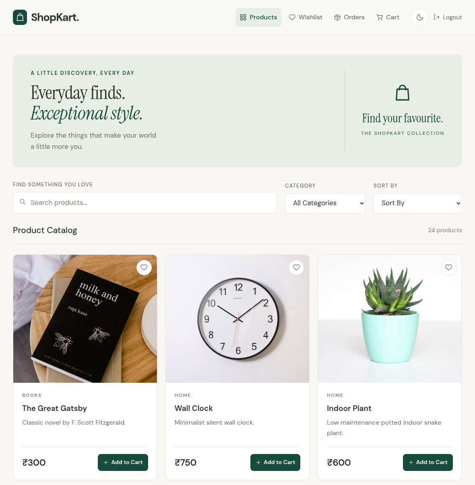
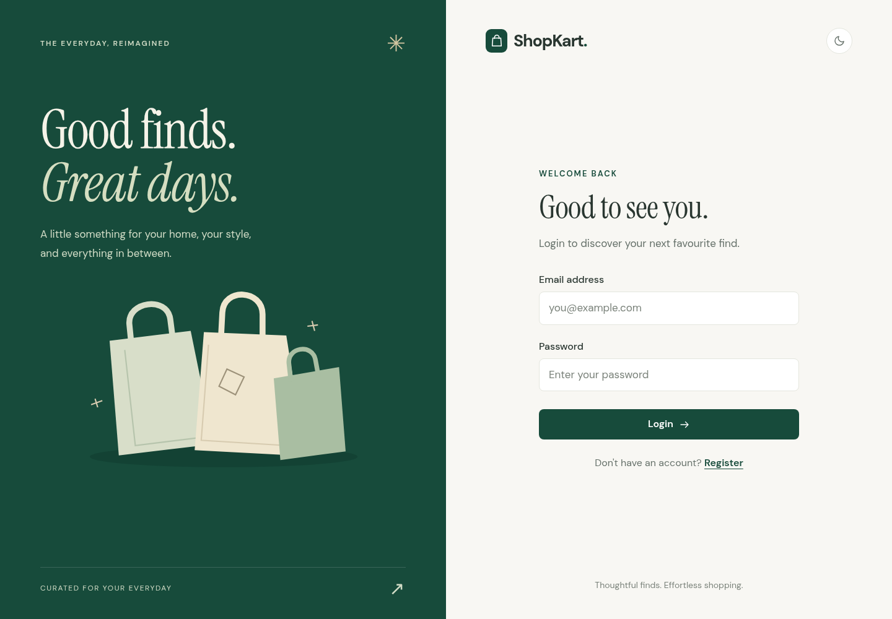
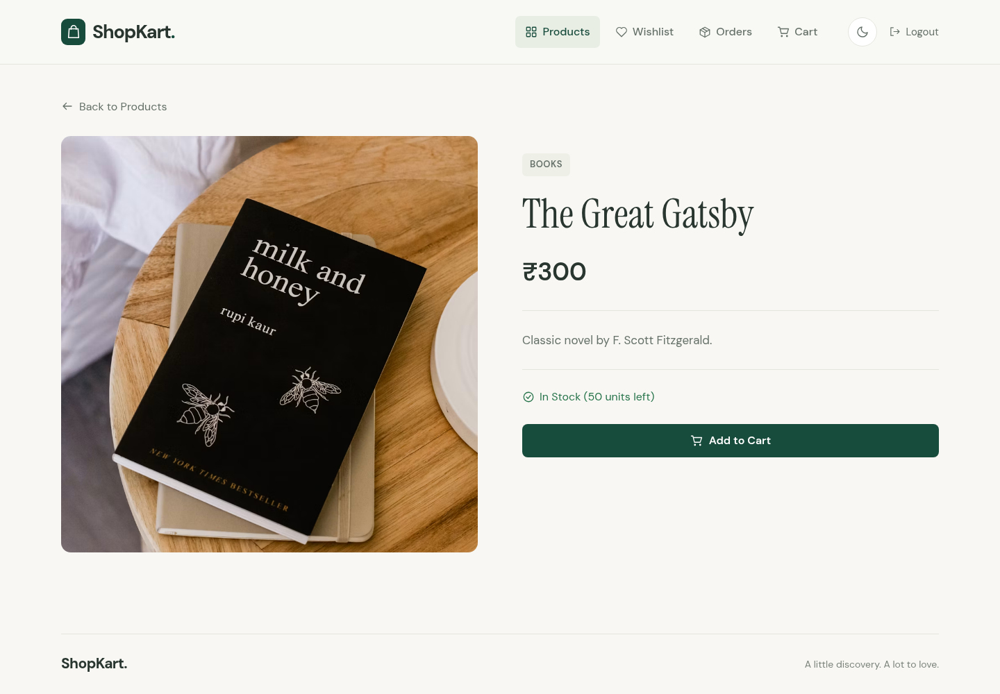
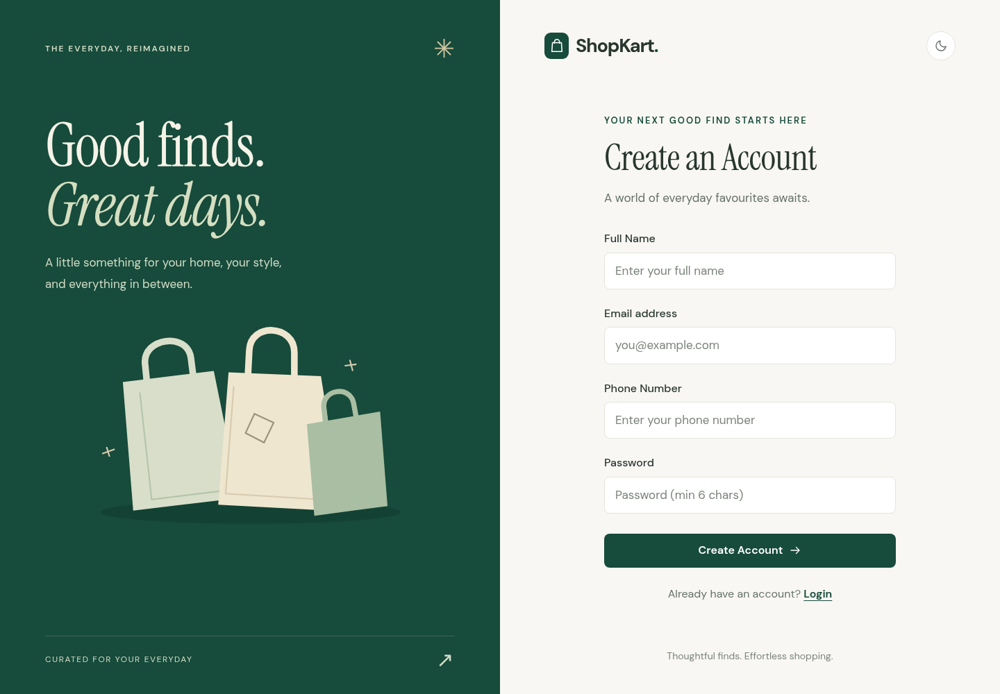
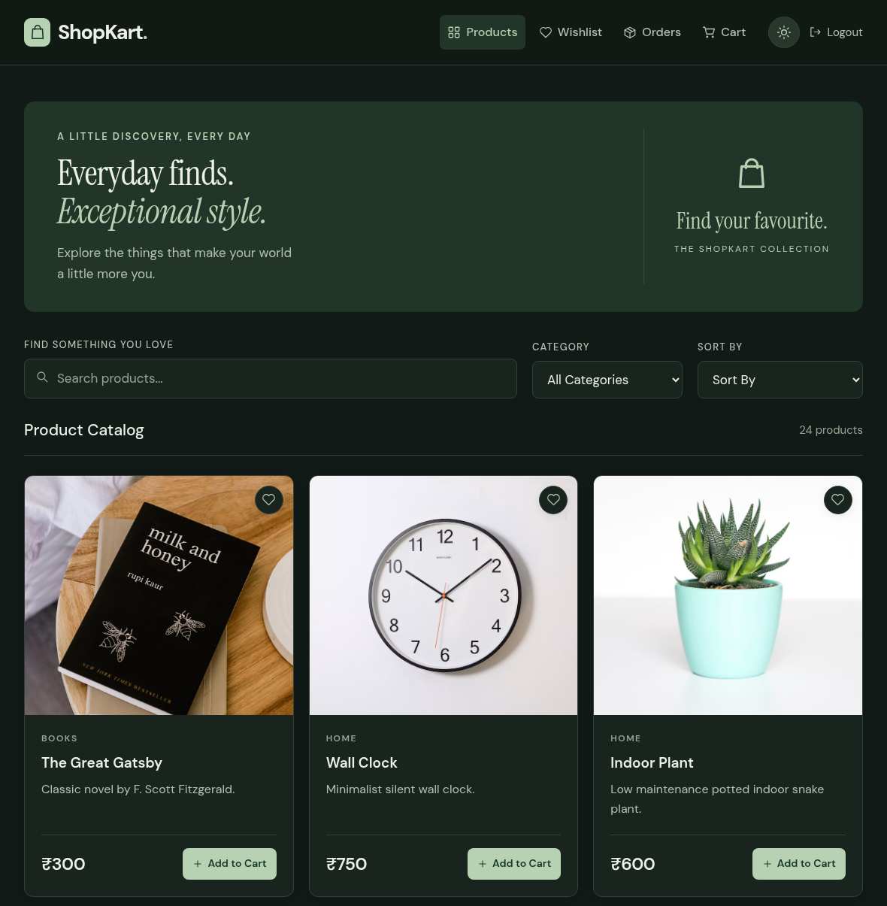
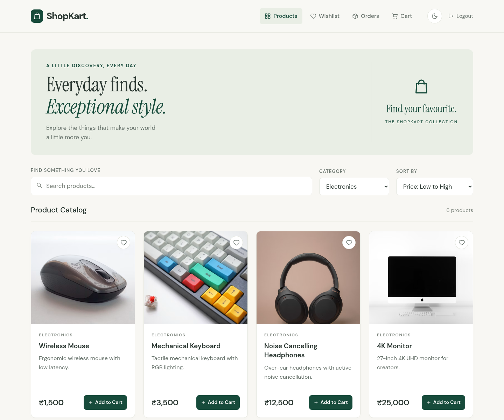
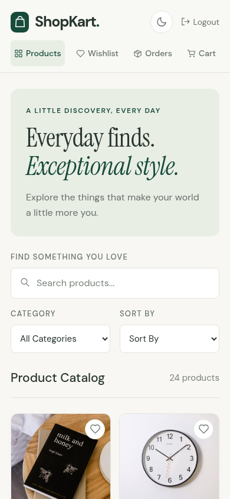
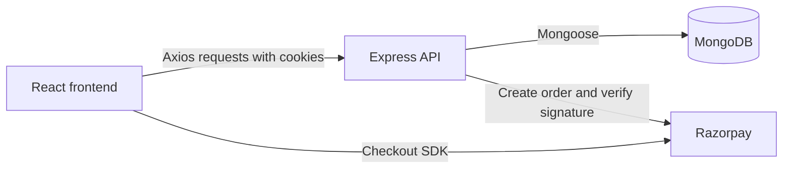

<div align="center">


# ShopKart

**Everyday finds. Exceptional style.**

A full-stack shopping app with product discovery, wishlists, a persistent cart, and Razorpay checkout.

[Source Code](https://github.com/Shreshtha280407/Lab-Project-Scaler)


</div>



*The running local catalog, connected to MongoDB through Docker. See [Screenshots](#screenshots) for capture details.*

## Contents

- [Features](#features)
- [Screenshots](#screenshots)
- [Tech stack and architecture](#tech-stack-and-architecture)
- [Local setup](#local-setup)
- [Environment variables](#environment-variables)
- [Add your first product](#add-your-first-product)
- [Try the shopping flow](#try-the-shopping-flow)
- [API reference](#api-reference)
- [Project structure](#project-structure)
- [Available commands](#available-commands)
- [Troubleshooting](#troubleshooting)
- [License](#license)

## Features

- **Customer accounts:** registration, login, logout, and profile details, with bcrypt password hashing and JWT authentication through an HTTP-only cookie.
- **Product discovery:** search by name, filter by Electronics, Fashion, Books, or Home, and sort prices from low to high or high to low.
- **Product details:** images, descriptions, INR pricing, and available stock.
- **Wishlist:** save products to your account and remove them later.
- **Shopping cart:** store items in MongoDB, change quantities, remove items, and calculate the subtotal. Cart updates check available stock.
- **Checkout:** collect a shipping address and pay through Razorpay. The backend verifies the payment signature, records the order, updates stock, and clears the cart after successful verification.
- **Order history:** view your orders, purchased items, shipping details, and order status.
- **Responsive interface:** desktop and mobile layouts, plus light and dark themes saved in the browser.

## Screenshots

Catalog, product details, filtering, and theme screenshots are from the running local frontend and backend, using the existing Docker MongoDB database.

A fresh local database starts empty; [add a product](#add-your-first-product) to populate it.

| Login | Product details |
| --- | --- |
|  |  |

<details>
<summary><strong>See registration, dark mode, filtering, and mobile screenshots</strong></summary>

### Registration



### Dark theme



### Category filtering and price sorting



### Mobile catalog



</details>

## Tech stack and architecture

| Layer | Technologies |
| --- | --- |
| Frontend | React 18, Vite 5, React Router 6, Axios, CSS |
| Backend | Node.js, Express 5, ES modules |
| Database | MongoDB, Mongoose 9 |
| Authentication | JSON Web Tokens, bcrypt, cookie-parser |
| Payments | Razorpay Node SDK and browser Checkout SDK |



During local development, Vite forwards `/api/*` requests to `http://127.0.0.1:5000` and removes the `/api` prefix.

## Local setup

### Prerequisites

- **Node.js 20.19.0 or newer** and npm. Mongoose 9 and its MongoDB driver require this minimum version.
- **Git** to clone the repository.
- **Docker** for the database setup below, or an existing MongoDB instance / MongoDB Atlas connection.
- **Razorpay test credentials** to exercise payments. Browsing products and using accounts, carts, and wishlists do not require working payment credentials.

The commands below use a Bash-compatible shell. On Windows PowerShell, use `Copy-Item .env.example .env` in place of `cp .env.example .env`.

### 1. Clone the repository

```bash
git clone https://github.com/Shreshtha280407/Lab-Project-Scaler.git
cd Lab-Project-Scaler
```

### 2. Run MongoDB with Docker

This project was developed on **Arch Linux with MongoDB running in Docker**, because the native MongoDB setup was not working on the development machine. The same container setup can be used on other operating systems with Docker installed.

<details>
<summary>Install and start Docker Engine on Arch Linux</summary>

Install the [Docker package from the Arch repositories](https://archlinux.org/packages/extra/x86_64/docker/) and start its service:

```bash
sudo pacman -Syu docker
sudo systemctl enable --now docker.service
```

If your account does not have access to the Docker daemon, prefix the Docker commands below with `sudo`. If you use Docker Desktop, start Docker Desktop instead.

</details>

For a new setup, create a persistent volume and start a MongoDB container:

```bash
docker volume create shopkart-mongo-data

docker run -d \
  --name shopkart-mongo \
  --restart unless-stopped \
  -p 127.0.0.1:27017:27017 \
  --mount type=volume,source=shopkart-mongo-data,target=/data/db \
  mongo:8
```

This uses the [Docker official MongoDB image](https://hub.docker.com/_/mongo). The named volume keeps database files across container restarts, and the port mapping makes MongoDB available on the local machine at `127.0.0.1:27017`.

Check that MongoDB is ready:

```bash
docker ps --filter name=shopkart-mongo
docker exec shopkart-mongo mongosh --quiet --eval 'db.adminCommand({ ping: 1 })'
```

The ping response should include `ok: 1`.

If the container already exists, reuse it with `docker start shopkart-mongo` instead of running `docker run` again. To stop or restart it later:

```bash
docker stop shopkart-mongo
docker start shopkart-mongo
```

**Using an existing MongoDB installation or Atlas?** Skip the container commands and set `MONGODB_URI` to your connection string in the next step. A local installation can use the same URI shown below.

### 3. Configure and start the backend

In your first terminal, from the repository root:

```bash
cd backend
npm ci
cp .env.example .env
```

Edit `backend/.env`:

```dotenv
PORT=5000
MONGODB_URI=mongodb://127.0.0.1:27017/shopkart
JWT_SECRET=replace_with_a_long_random_secret
RAZORPAY_KEY_ID=your_razorpay_test_key_id
RAZORPAY_KEY_SECRET=your_razorpay_test_key_secret
```

Generate a value for `JWT_SECRET` if needed:

```bash
node -e "console.log(require('node:crypto').randomBytes(32).toString('hex'))"
```

Start the API:

```bash
npm run dev
```

Once MongoDB connects, the terminal should show:

```text
Connected to MongoDB
Server is running on port 5000
```

The backend is available at `http://localhost:5000`. It starts listening **after a successful database connection**.

### 4. Start the frontend

In a second terminal, from the repository root:

```bash
cd frontend
npm ci
npm run dev
```

Open **http://localhost:5173**. Vite prints the actual address in the terminal and may choose another port if `5173` is already occupied.

No frontend environment file is needed. Axios defaults to `/api`, and the Vite development proxy connects it to the backend on port `5000`.

### 5. Verify the connection

With both servers running:

```bash
curl http://localhost:5000/products
curl http://localhost:5173/api/products
```

Both should return JSON with `count` and `products`. With a fresh database, the expected response is:

```json
{ "count": 0, "products": [] }
```

The default local addresses are:

| Service | Address |
| --- | --- |
| React frontend | `http://localhost:5173` |
| Express backend | `http://localhost:5000` |
| MongoDB in Docker | `mongodb://127.0.0.1:27017/shopkart` |

## Environment variables

### Backend · `backend/.env`

| Variable | Purpose |
| --- | --- |
| `PORT` | API port; defaults to `5000`. The local Vite proxy targets port `5000`. |
| `MONGODB_URI` | MongoDB connection string, including the database name. |
| `JWT_SECRET` | Secret used to sign and verify login tokens. |
| `RAZORPAY_KEY_ID` | Razorpay key ID; use a test-mode key for development. |
| `RAZORPAY_KEY_SECRET` | Server-side Razorpay secret used for order creation and signature verification. |

Keep database credentials, `JWT_SECRET`, and `RAZORPAY_KEY_SECRET` in the backend environment. The repository ignores `.env` files.

## Add your first product

There is no database seed command in the repository. A fresh MongoDB database needs product data before the catalog can show items.

Run this example against your **local development API**:

```bash
curl -X POST http://localhost:5000/products \
  -H 'Content-Type: application/json' \
  --data '{
    "name": "Ceramic Coffee Mug",
    "description": "An everyday ceramic mug for your morning coffee.",
    "price": 450,
    "category": "Home",
    "image": "https://images.unsplash.com/photo-1514228742587-6b1558fcca3d?auto=format&fit=crop&w=800&q=80",
    "stock": 25
  }'
```

A successful request returns the created product with its MongoDB `_id`. Repeat with other products as needed, then open `/products` in the frontend. Use `Electronics`, `Fashion`, `Books`, or `Home` to match the category options in the interface.

## Try the shopping flow

1. Open the frontend and choose **Register**. Enter a name, email, phone number, and a password of at least six characters.
2. Log in with the new account and select **Start Shopping** from your profile.
3. Browse the catalog, try search/filter/sort, or open a product to view its details.
4. Save an item to your wishlist or add an in-stock item to your cart.
5. Open **Cart**, adjust quantities, and select **Proceed to Checkout**.
6. Enter the shipping details, including a six-digit pincode, and select **Place Order & Pay**.
7. Complete a Razorpay **test-mode** payment with valid test credentials. Successful backend verification places the order, updates stock, and clears the cart.
8. Open **Orders** to view the order and its details.

Get test credentials from your [Razorpay Dashboard](https://dashboard.razorpay.com/). Checkout needs internet access to load Razorpay's browser SDK and reach its API.

## API reference

Local base URL: `http://localhost:5000`.

Protected routes expect the `jwt` cookie issued by `POST /customers/login`.

| Method | Endpoint | Purpose | Login required |
| --- | --- | --- | --- |
| `POST` | `/customers/register` | Create an account | No |
| `POST` | `/customers/login` | Sign in and set the JWT cookie | No |
| `GET` | `/customers/me` | Get the signed-in customer's profile | Yes |
| `POST` | `/customers/logout` | Sign out | Yes |
| `PATCH` | `/customers/change-password` | Change a password | Yes |
| `GET` | `/products` | List, search, filter, and sort products | No |
| `GET` | `/products/:id` | Get a product | No |
| `POST` | `/products` | Create a product | No |
| `GET` | `/wishlist` | Get your wishlist | Yes |
| `POST` / `DELETE` | `/wishlist/:productId` | Add or remove a wishlist item | Yes |
| `PATCH` | `/wishlist/:productId/toggle` | Toggle a wishlist item | Yes |
| `GET` | `/cart` | Get your cart | Yes |
| `POST` | `/cart/:productId` | Add one unit to the cart | Yes |
| `PATCH` | `/cart/:productId` | Set the quantity with `{ "quantity": 2 }` | Yes |
| `DELETE` | `/cart/:productId` | Remove a cart item | Yes |
| `POST` | `/orders/create-payment-order` | Create a pending order and Razorpay order | Yes |
| `POST` | `/orders/verify-payment` | Verify the payment and place the order | Yes |
| `GET` | `/orders` | List your orders | Yes |
| `GET` | `/orders/:id` | Get one of your orders | Yes |

Product listing accepts `search`, `category`, and `sort` query parameters. Valid price sorts are `price_asc` and `price_desc`; the default sort shows newest products first.

```bash
curl 'http://localhost:5000/products?category=Electronics&sort=price_asc'
curl 'http://localhost:5000/products?search=mug'
```

## Project structure

```text
Lab-Project-Scaler/
├── backend/
│   ├── config/            # Razorpay client configuration
│   ├── controllers/       # Customers, products, cart, wishlist, orders
│   ├── middlewares/       # JWT cookie authentication
│   ├── models/            # Mongoose customer, product, and order models
│   ├── routes/            # Express route definitions
│   ├── utils/             # JWT generation
│   ├── .env.example       # Backend configuration template
│   ├── index.js           # Middleware, routes, database connection, server
│   └── package.json
├── frontend/
│   ├── public/            # Favicon
│   ├── src/
│   │   ├── components/    # Navigation, layouts, icons, product cards
│   │   ├── context/       # Cart and theme state
│   │   ├── pages/         # Auth, profile, catalog, checkout, orders
│   │   ├── services/      # Axios API client
│   │   ├── App.jsx        # Client-side routes
│   │   ├── index.css      # Styling and responsive layouts
│   │   └── main.jsx       # React entry point
│   ├── index.html
│   ├── vite.config.js     # React plugin and local API proxy
│   └── package.json
├── docs/screenshots/      # Screenshots used in this README
├── LICENSE
└── README.md
```

## Available commands

Run each command from the directory listed:

| Directory | Command | Purpose |
| --- | --- | --- |
| `backend` | `npm ci` | Install dependencies from the lockfile |
| `backend` | `npm run dev` | Start the API with nodemon |
| `backend` | `npm start` | Start the API with Node.js |
| `frontend` | `npm ci` | Install dependencies from the lockfile |
| `frontend` | `npm run dev` | Start the Vite development server |
| `frontend` | `npm run build` | Build the frontend for production |
| `frontend` | `npm run preview` | Preview the frontend build locally |

There is no configured automated test suite; the backend's `npm test` script is a placeholder. Use the API checks and shopping flow above to verify a local setup.

## Troubleshooting

| Problem | What to check |
| --- | --- |
| Backend never starts listening | Confirm MongoDB is running, check `MONGODB_URI`, and read the backend's connection error. Listening begins after MongoDB connects. |
| MongoDB refuses the connection | Run `docker start shopkart-mongo`, check `docker logs shopkart-mongo`, and confirm port `27017` is published. Use `127.0.0.1` in the local MongoDB URI. |
| Docker reports permission denied | Start the Docker daemon/Desktop and use `sudo` for Docker Engine commands if your account lacks daemon access. |
| Container name is already in use | Reuse the existing container with `docker start shopkart-mongo`. |
| Port `27017` is occupied | Reuse the existing MongoDB instance, or publish a different host port and update `MONGODB_URI` to match. |
| Catalog is empty | Add a product to the database used by the backend. A fresh clone includes no seeded database. |
| Frontend cannot load products locally | Confirm the API is running on port `5000` and check `/api/products` through Vite. If you changed `PORT`, update the proxy target in `frontend/vite.config.js`. |
| Checkout fails | Supply valid Razorpay credentials from the same test-mode account, confirm internet access, and inspect backend payment errors. |

## License

Released under the [MIT License](LICENSE). Built by [Shreshtha](https://github.com/Shreshtha280407).
